# Bilcode Waste

Sistem pelaporan dan penanganan sampah: warga memotret sampah, model AI menyarankan kategorinya
(Organik, Plastik, Kertas), lokasi diambil dari GPS, lalu admin menindaklanjuti laporan sampai selesai
dengan riwayat status yang bisa dilihat pelapor.

Dibuat oleh **Akhyar** untuk _Technical Coding Test Fullstack Developer_ Bilcode Technology.
Ini proyek penilaian, bukan layanan resmi Bilcode. Seluruh laporan di demo adalah data simulasi.

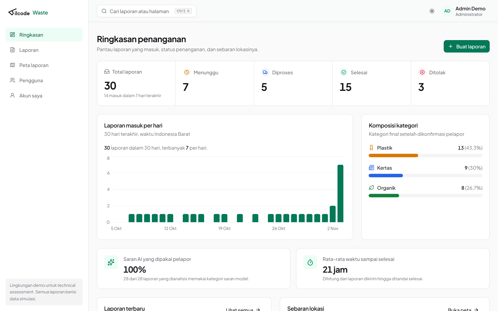

## Coba sekarang

| Komponen                  | Tautan                                                                                       |
| ------------------------- | -------------------------------------------------------------------------------------------- |
| Website                   | https://bilcode-waste-web.vercel.app                                                         |
| Dokumentasi API (Swagger) | https://bilcode-waste-api.vercel.app/docs                                                    |
| Status API dan database   | https://bilcode-waste-api.vercel.app                                                         |
| APK Android               | [Rilis terbaru](https://github.com/Akhyarrrrr/bilcode-waste/releases/latest) (APK + SHA-256) |
| Status layanan model      | https://bilcode-waste-ml.vercel.app                                                          |
| Notebook pelatihan        | [`ml/training.ipynb`](ml/training.ipynb), sudah dijalankan dan berisi output                 |

| Peran   | Email                      | Kata sandi          |
| ------- | -------------------------- | ------------------- |
| Admin   | `admin@bilcode-waste.test` | `BilcodeAdmin2026!` |
| Pelapor | `user@bilcode-waste.test`  | `BilcodeUser2026!`  |

Kedua akun demo **dikunci di server**: kata sandi, email, peran, dan statusnya tidak bisa diubah, supaya
penilai berikutnya tetap bisa masuk. Untuk mencoba ganti profil atau kata sandi, daftarkan akun baru.
Paket hosting gratis bisa membuat permintaan pertama lebih lambat (cold start).

## Yang dibangun

| Kebutuhan dari Bilcode                               | Implementasi                                                                                                         |
| ---------------------------------------------------- | -------------------------------------------------------------------------------------------------------------------- |
| **A. Website**                                       |                                                                                                                      |
| Login dan autentikasi berbasis role                  | Sesi cookie HttpOnly; route dan aksi dijaga untuk Admin dan Pelapor, di web maupun API                               |
| Dashboard statistik                                  | Jumlah per status, tren 30 hari (WIB), komposisi kategori, kesesuaian saran AI, rata-rata waktu selesai, peta        |
| CRUD laporan                                         | Wizard 3 langkah (foto + AI, detail + peta, tinjau); ubah dan hapus dengan pengecekan versi                          |
| Filter dan pencarian                                 | Kata kunci, status (dengan jumlah per tab), kategori, rentang tanggal; tersimpan di URL                              |
| Manajemen pengguna                                   | Tambah, ubah peran, nonaktifkan, filter; admin aktif terakhir tidak bisa diturunkan                                  |
| Update status Pending/In Progress/Completed/Rejected | Hanya transisi yang sah, catatan wajib saat menolak, riwayat aktor dan waktu dalam satu transaksi                    |
| Responsive                                           | Diuji di 360, 768, dan 1440 px; tabel menjadi daftar di layar kecil; mode gelap                                      |
| **B. Mobile (Android)**                              |                                                                                                                      |
| Register dan login                                   | Token sesi disimpan di SecureStore, sesi dipulihkan saat aplikasi dibuka                                             |
| Dashboard pengguna                                   | Ringkasan status, laporan terbaru, tombol cepat buat laporan                                                         |
| Laporan dengan foto, GPS, deskripsi                  | Kamera atau galeri, kompresi di perangkat, GPS dengan akurasi dan peta statis                                        |
| Riwayat dan status                                   | Daftar dengan filter status, tab Aktivitas untuk setiap pembaruan petugas, detail dengan timeline penanganan         |
| Integrasi API                                        | Klien HTTP bersama (`packages/contracts`) dengan TanStack Query                                                      |
| AI image detection                                   | Prediksi dari model asli, probabilitas tiap kategori, kategori saran terpilih otomatis, pilihan manual bila AI gagal |
| **C. Machine learning**                              |                                                                                                                      |
| Klasifikasi minimal 3 kategori                       | Organik, Plastik, Kertas                                                                                             |
| Dataset minimal 150 gambar                           | 2.268 gambar RealWaste, dengan sumber, lisensi, dan checksum                                                         |
| Python + PyTorch, training dan testing               | MobileNetV3-Small transfer learning; [notebook](ml/training.ipynb) dan [script](ml/scripts)                          |
| Accuracy, confusion matrix, classification report    | Akurasi uji **98,53%** (335/340), macro F1 0,9865; lihat [hasil evaluasi](#machine-learning)                         |
| REST API prediksi                                    | FastAPI + ONNX Runtime, dipanggil API Node dengan kunci internal                                                     |

Fitur tambahan: panel AI lengkap di web dan mobile, export CSV laporan untuk admin (mengikuti filter
aktif), mode gelap di web dan mobile, pencarian global `Ctrl K`, dan landing page publik.

<p>
  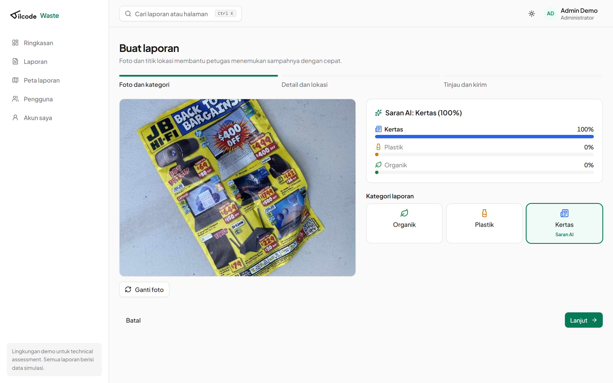
  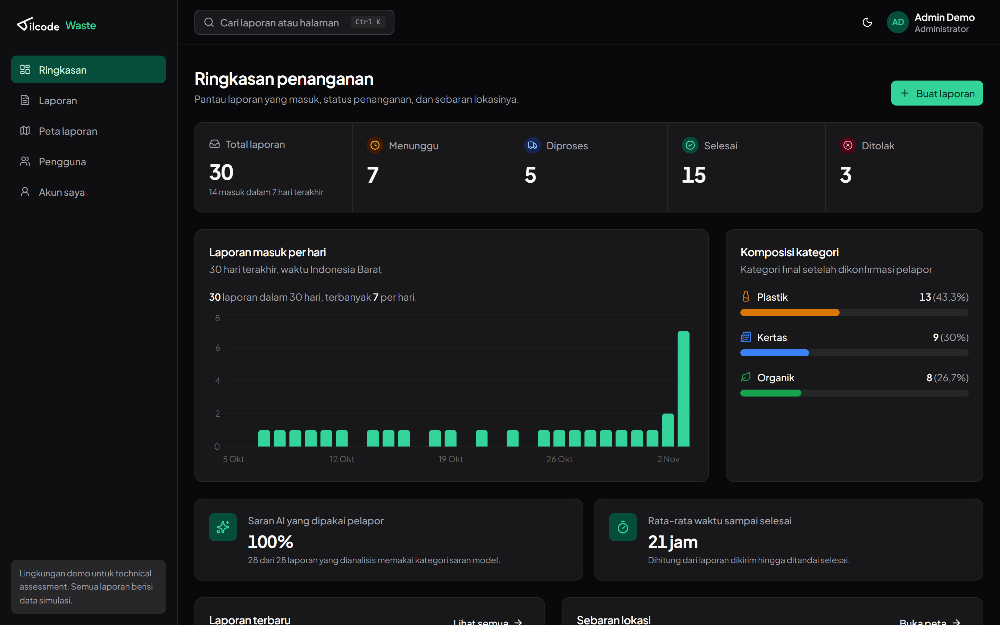
</p>

## Tampilan

| Daftar laporan dengan filter dan jumlah per status    | Detail laporan dengan panel AI dan riwayat                |
| ----------------------------------------------------- | --------------------------------------------------------- |
| 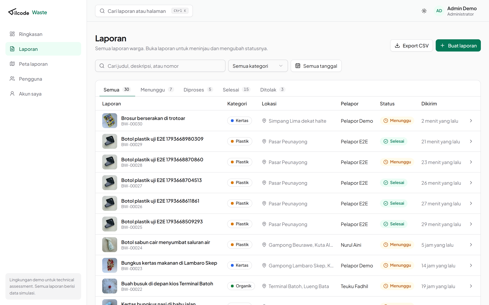   | 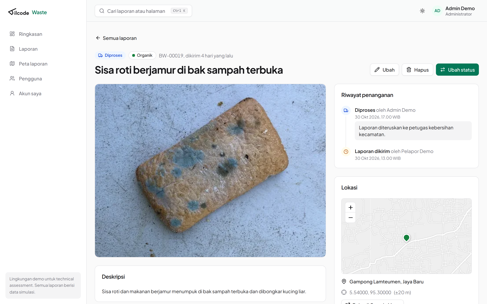 |
| **Manajemen pengguna**                                | **Landing page publik**                                   |
| 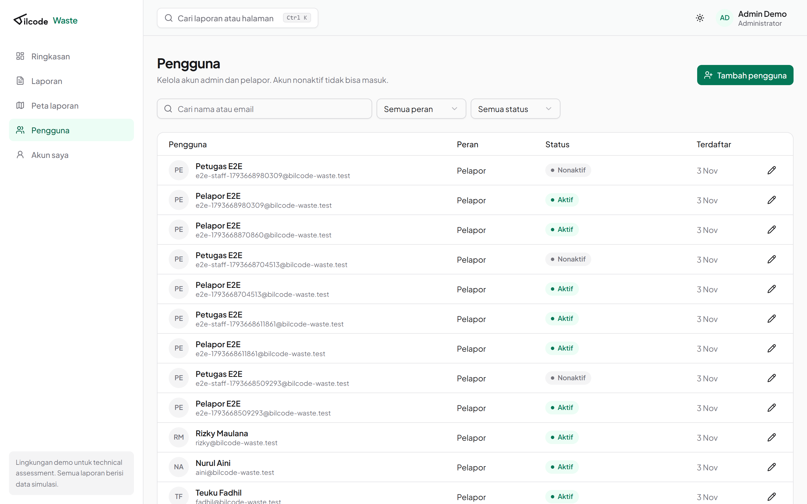 | 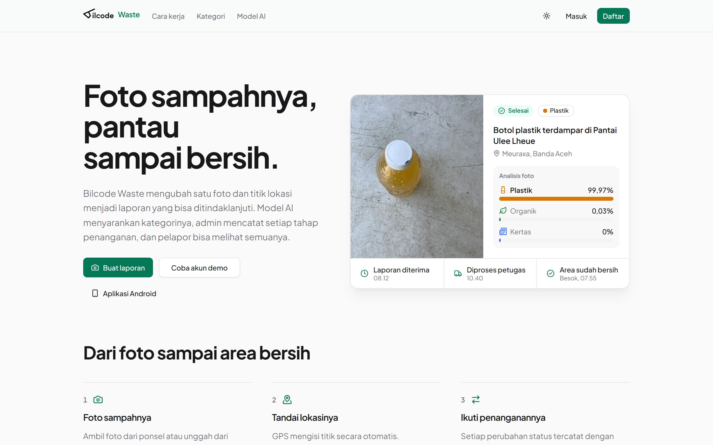         |

| Web di ponsel                                              | Android: beranda                                     | Android: aktivitas                                         | Android: saran AI                                          | Android: detail                                       |
| ---------------------------------------------------------- | ---------------------------------------------------- | ---------------------------------------------------------- | ---------------------------------------------------------- | ----------------------------------------------------- |
| 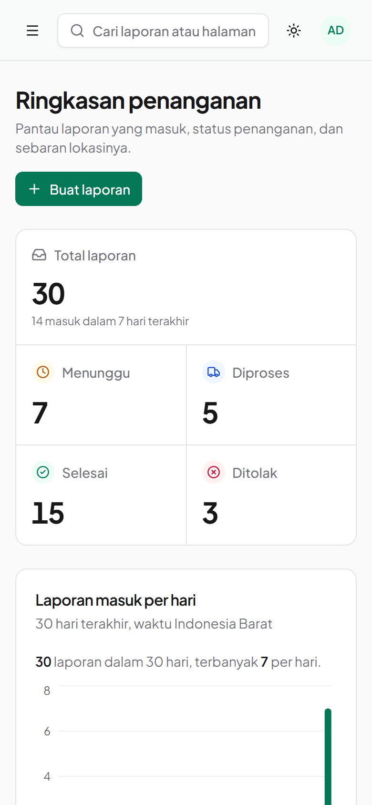 | 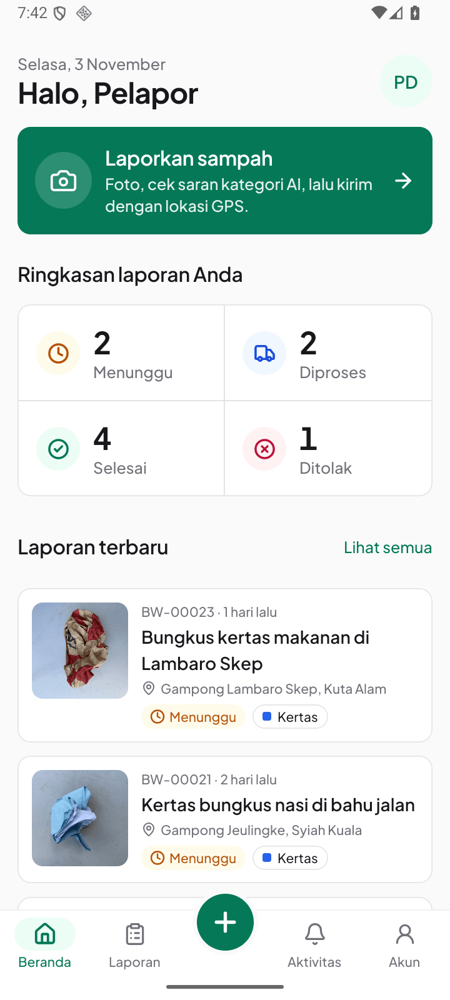 | 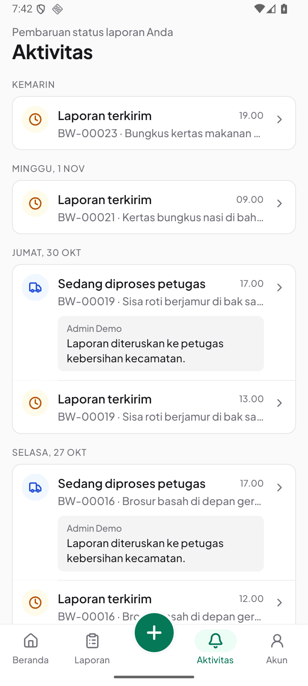 | 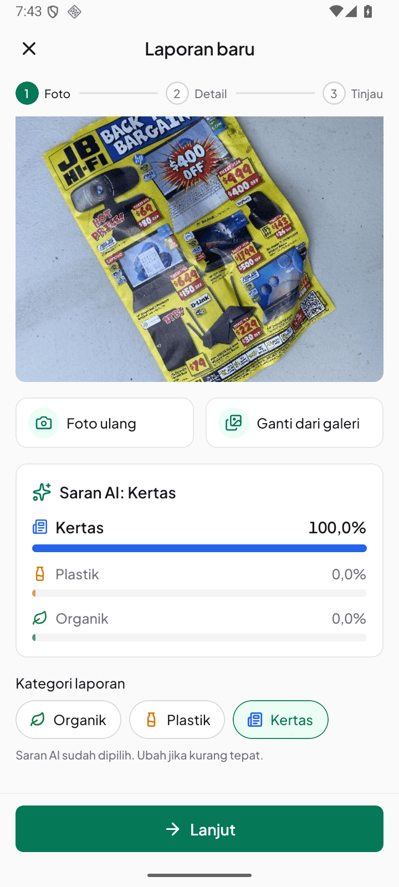 | 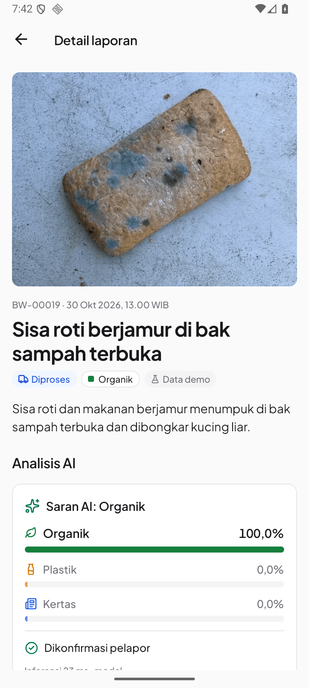 |

## Tech stack dan alasannya

| Lapisan    | Pilihan                                                | Alasan                                                                                                                                                                     |
| ---------- | ------------------------------------------------------ | -------------------------------------------------------------------------------------------------------------------------------------------------------------------------- |
| Bahasa     | TypeScript di web, mobile, dan API                     | Satu paket kontrak (`packages/contracts`) berisi tipe DTO, label, aturan transisi status, dan klien HTTP; perubahan kontrak langsung terdeteksi di ketiga aplikasi.        |
| Web        | React 19 + Vite, React Router, TanStack Query          | Dashboard internal tidak butuh SSR atau SEO per halaman, jadi SPA lebih sederhana dideploy. Query cache menangani loading, refetch, dan invalidasi setelah mutasi.         |
| UI web     | Tailwind CSS v4 + shadcn/ui (Radix), Recharts          | Komponen Radix sudah aksesibel (fokus, keyboard, ARIA). Kode komponen ada di repo sehingga bisa disesuaikan. Token warna dipakai bersama dengan mobile.                    |
| Mobile     | React Native + Expo (Router, SecureStore, Location)    | Satu bahasa dengan web, akses kamera dan GPS lewat modul resmi Expo, dan build APK lewat EAS tanpa mengelola Gradle manual.                                                |
| Backend    | Node.js + Fastify                                      | Validasi request dan serialisasi response memakai JSON Schema yang sama dengan OpenAPI, jadi dokumentasi tidak bisa berbeda dari perilaku. `inject()` memudahkan tes HTTP. |
| Database   | PostgreSQL + Prisma                                    | Data relasional (pengguna, laporan, riwayat status) butuh foreign key, constraint, transaksi, dan advisory lock. Prisma memberi migration yang bisa diaudit dan tipe aman. |
| ML         | PyTorch (MobileNetV3-Small), scikit-learn untuk metrik | Transfer learning dari ImageNet mencapai akurasi tinggi dengan data terbatas; model kecil (6 MB) cocok untuk layanan serverless.                                           |
| Serving ML | FastAPI + ONNX Runtime                                 | Layanan prediksi tidak perlu PyTorch (lebih ringan); hasil ONNX diuji sama dengan PyTorch (selisih probabilitas maksimum 0,0000077).                                       |
| Hosting    | Vercel (3 proyek), Neon PostgreSQL, Vercel Blob privat | Gratis untuk demo, deploy otomatis dari GitHub, dan foto tetap privat, hanya diakses lewat URL bertanda tangan dari API.                                                   |

## Arsitektur

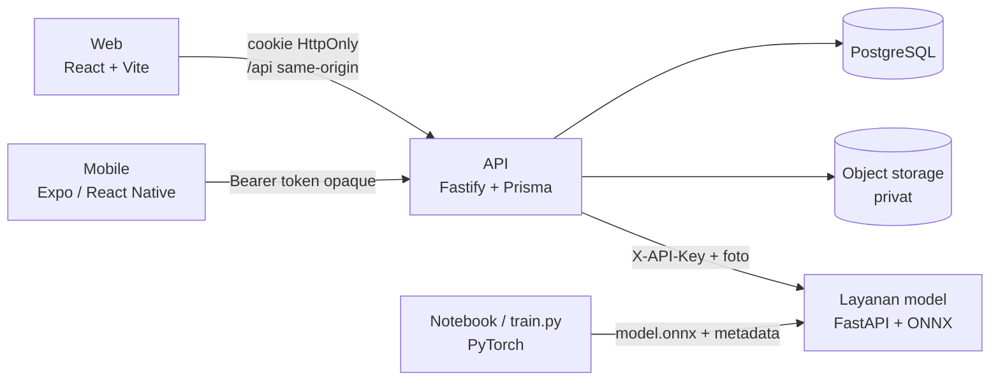

Alur satu laporan:

1. Klien mengompres foto (≤1.600 px) lalu mengirimnya ke `POST /uploads`. API memeriksa isi file (bukan
   ekstensinya), membatasi ukuran dan dimensi, menghapus EXIF, lalu menyimpannya sebagai WebP privat.
2. `POST /predictions` mengirim foto itu ke layanan model, memvalidasi bentuk respons, lalu menyimpan
   prediksi. Jika model tidak tersedia, API membalas 503 dan klien menawarkan pilihan manual.
3. Pelapor mengonfirmasi atau mengubah kategori. `POST /reports` membawa `clientRequestId`, jadi
   permintaan yang terkirim ulang tidak membuat laporan ganda. Prediksi asli tetap tersimpan untuk audit.
4. Admin mengubah status lewat `PATCH /reports/:id/status` dengan nomor versi. Perubahan status dan
   riwayatnya ditulis dalam satu transaksi, dan permintaan dengan versi yang sudah usang ditolak (409).

Skema database ada di [docs/ERD.md](docs/ERD.md).

## Machine learning

| Metrik (340 gambar uji, tidak dipakai saat memilih model) | Hasil                |
| --------------------------------------------------------- | -------------------- |
| Accuracy                                                  | **98,53%** (335/340) |
| Macro F1                                                  | 0,9865               |
| Kesamaan label PyTorch dan ONNX                           | 100%                 |

| Kategori | Precision | Recall |    F1 | Jumlah uji |
| -------- | --------: | -----: | ----: | ---------: |
| Organik  |     0,977 |  0,992 | 0,984 |        127 |
| Plastik  |     0,985 |  0,978 | 0,982 |        138 |
| Kertas   |     1,000 |  0,987 | 0,993 |         75 |

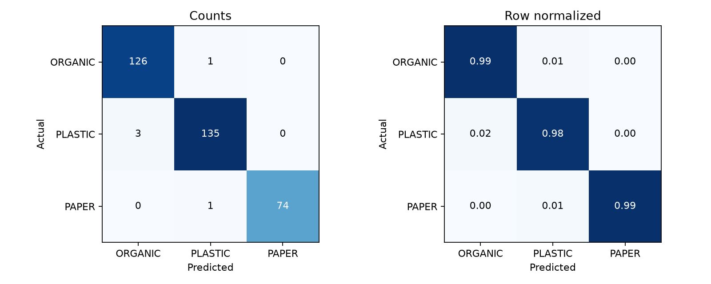

- Dataset: [RealWaste](https://doi.org/10.24432/C5SS4G) (Single, Iranmanesh, Raad, 2023). _Food Organics_
  dan _Vegetation_ menjadi Organik, _Plastic_ menjadi Plastik, _Paper_ menjadi Kertas.
- Foto yang hampir kembar dikelompokkan dengan perceptual hash dan tidak pernah terpisah ke split berbeda,
  sehingga tidak ada kebocoran ke data uji.
- Model dipilih dari macro F1 validasi; pilihan dikunci sebelum data uji dibaca. Menjalankan ulang
  notebook menghasilkan angka yang sama persis dengan model yang dideploy.

Detail data, pelatihan, reproduksi, dan batasan: [docs/ML.md](docs/ML.md).

## Keamanan dan integritas data

- Token sesi acak 256-bit; database hanya menyimpan hash SHA-256-nya. Cookie web HttpOnly + SameSite,
  dan setiap request browser yang mengubah data dicek `Origin`-nya.
- Kata sandi di-hash dengan Argon2id. Mengganti kata sandi, peran, atau email, atau menonaktifkan akun,
  langsung mencabut semua sesi pengguna itu.
- Rate limit tersimpan di database: login dan daftar per email dan per IP, unggahan dan prediksi per pengguna.
- Pelapor hanya melihat laporannya sendiri dan hanya bisa mengubah atau menghapus saat masih Menunggu.
  Admin tidak bisa melompati tahap status, dan admin aktif terakhir tidak bisa diturunkan.
- Foto disimpan privat; klien hanya menerima URL bertanda tangan yang kedaluwarsa.
- Export CSV menetralkan teks yang bisa dijalankan spreadsheet sebagai rumus (CSV injection).
- Statistik dihitung di database (`groupBy`) dengan cakupan data yang sama seperti daftar laporan.

## Menjalankan secara lokal

Prasyarat: Node.js 24, Docker, dan Python 3.12 dengan [uv](https://docs.astral.sh/uv/). Untuk mobile:
emulator Android atau Expo Go (SDK 58).

```bash
npm ci
docker compose up -d postgres
cp apps/api/.env.example apps/api/.env   # isi SESSION_SECRET, ML_API_KEY, kata sandi seed
npm run db:migrate
npm run db:seed                          # 6 akun demo + 24 laporan di Banda Aceh
```

Lalu jalankan di tiga terminal:

```bash
npm run dev:api
```

```bash
uv run --project ml/inference --env-file apps/api/.env uvicorn app:app --app-dir ml/inference --port 8000
```

```bash
npm run dev
```

Web di http://localhost:5173, Swagger di http://localhost:3001/docs.

Mobile: salin `apps/mobile/.env.example` ke `.env`, isi `EXPO_PUBLIC_API_URL`
(emulator Android: `http://10.0.2.2:3001/api/v1`), jalankan `npm run dev:mobile`, lalu buka di Expo Go.
Detail di [docs/MOBILE.md](docs/MOBILE.md).

`npm run db:seed -- --reset` menghapus laporan milik akun `@bilcode-waste.test` lalu mengisi ulang data
demo. Akun di domain lain tidak disentuh.

## Pengujian

```bash
npm run db:test          # membuat database bilcode_test di Postgres lokal
npm run typecheck
npm run lint
npm test                 # API (dengan PostgreSQL sungguhan), web, mobile, kontrak
npm run test:e2e         # Playwright; API, model, dan web harus sedang berjalan
uv run --project ml/inference pytest ml/inference/test_app.py -q
```

| Bagian          | Cakupan                                                                                                                                              |
| --------------- | ---------------------------------------------------------------------------------------------------------------------------------------------------- |
| API (18 tes)    | Role escalation, kepemilikan, transisi status, versi usang, idempotensi, CSRF, rate limit, akun demo terkunci, admin terakhir, export CSV, statistik |
| Web (8 tes)     | Format tanggal dan angka, query filter, dialog status (transisi sah, alasan wajib saat menolak)                                                      |
| Mobile (32 tes) | Alur buat laporan, feed aktivitas, validasi, sesi, onboarding, tile peta                                                                             |
| E2E (7 alur)    | Daftar, lapor dengan foto + AI + GPS, admin memproses, export CSV, kelola pengguna, ganti sandi, responsif 360/768/1440 dan menu `Ctrl K`            |
| Model (pytest)  | Kunci API, batas ukuran, format gambar, bentuk respons                                                                                               |

CI GitHub Actions menjalankan typecheck, lint, seluruh unit test (dengan PostgreSQL), build, dan tes
layanan model di setiap push.

## Struktur repository

```text
apps/
  api/        Fastify API, Prisma schema, migration, seed, tes integrasi
  web/        React app: app/ (router, layout, provider), features/, components/
  mobile/     Expo app: app/ (route), src/features, src/components, src/theme
packages/
  contracts/  Tipe, label, aturan status, dan klien HTTP bersama
ml/
  scripts/    Unduh dataset, persiapan split, pelatihan, dan evaluasi
  artifacts/  Model terpilih (PyTorch + ONNX), metrik, grafik
  inference/  Layanan FastAPI + ONNX Runtime
  training.ipynb
docs/         API, ERD, ML, mobile, deployment, checklist penilaian
tests/e2e/    Playwright
```

## Dokumentasi lain

- [docs/API.md](docs/API.md): daftar endpoint dan contoh `curl`
- [docs/ERD.md](docs/ERD.md): skema database dan aturan integritas
- [docs/ML.md](docs/ML.md): dataset, pelatihan, evaluasi, dan serving model
- [docs/MOBILE.md](docs/MOBILE.md): aplikasi Android dan build APK
- [docs/DEPLOYMENT.md](docs/DEPLOYMENT.md): Vercel, Neon, dan environment variable
- [docs/DESIGN.md](docs/DESIGN.md): token warna, tipografi, dan komponen
- [docs/ASSETS.md](docs/ASSETS.md): atribusi logo, font, peta, dan foto
- [docs/ASSESSMENT.md](docs/ASSESSMENT.md): checklist kebutuhan dan bukti pengujian

## Batasan yang disadari

- Model mengklasifikasi material dominan pada satu foto, bukan mendeteksi beberapa objek. Confidence belum
  dikalibrasi, karena itu pelapor selalu mengonfirmasi kategorinya.
- RealWaste difoto di fasilitas sampah di Australia; foto lapangan di Indonesia bisa berbeda domainnya.
- Halaman peta menampilkan 100 laporan terbaru; untuk data besar perlu clustering dan paging per area.
- Hosting gratis memiliki cold start dan kuota. Lisensi dataset (CC BY-NC-SA pada rilis asli) membatasi
  pemakaian komersial.
