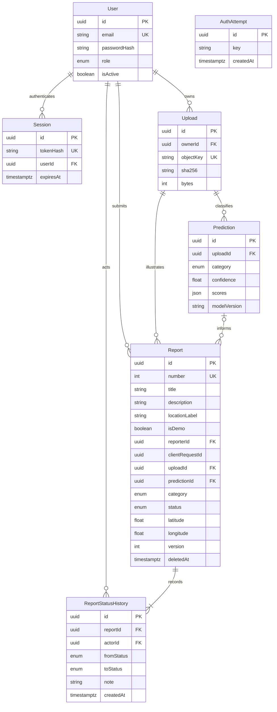

# Database dan integritas

Schema PostgreSQL `app` dipakai khusus untuk data aplikasi, tidak diekspos melalui Data API publik. Schema/migration sebenarnya berada di apps/api/prisma.

- Unique reporterId+clientRequestId menjaga idempotency; nomor laporan memakai sequence PostgreSQL.
- Indeks reporterId+createdAt dan status+category+createdAt mendukung scope/filter/pagination.
- Constraint memvalidasi rentang koordinat, akurasi nonnegatif, versi, ukuran foto, confidence dan durasi.
- Transaksi update status memakai pemeriksaan versi dan menyimpan riwayat dalam transaksi yang sama.
- Advisory transaction lock menyerialkan perubahan admin terakhir dan konsumsi rate limit lintas instance.
- `AuthAttempt` menyimpan hash scope dan timestamp percobaan; tidak menyimpan password atau email plaintext.
- Seluruh timestamp UTC bertipe timestamptz. Soft delete mengeluarkan laporan dari seluruh query daftar/statistik.
