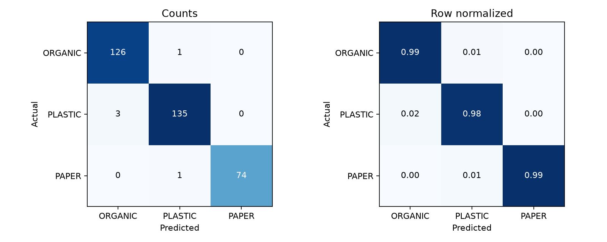
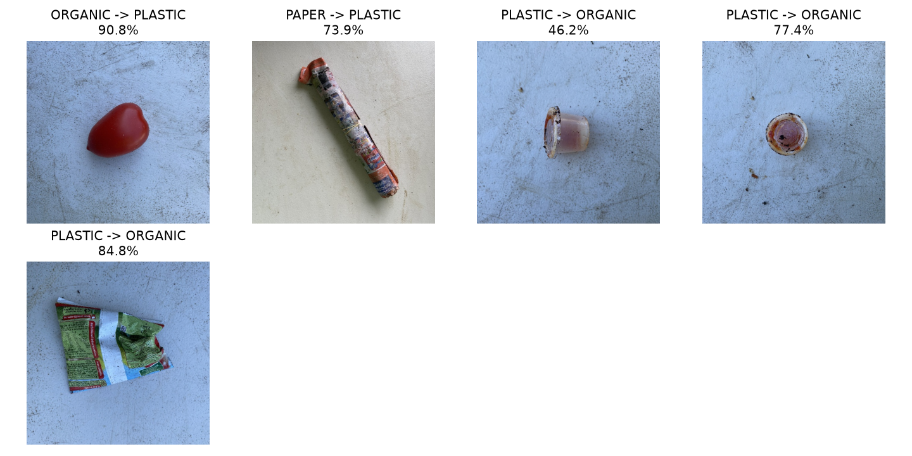
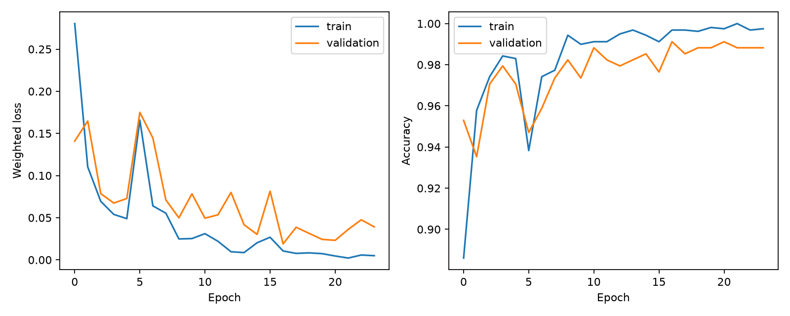

# Model klasifikasi sampah

Model tiga kelas (Organik, Plastik, Kertas) berbasis MobileNetV3-Small pretrained ImageNet, di-fine-tune
pada RealWaste dengan PyTorch. Di produksi, model berjalan sebagai ONNX di layanan FastAPI tanpa PyTorch.

- Notebook yang sudah dijalankan: [`ml/training.ipynb`](../ml/training.ipynb)
- Script: [`ml/scripts`](../ml/scripts), artefak dan metrik: [`ml/artifacts`](../ml/artifacts),
  model card: [`ml/artifacts/MODEL_CARD.md`](../ml/artifacts/MODEL_CARD.md)

## Hasil pada data uji

Data uji berisi 340 gambar yang tidak dipakai untuk melatih maupun memilih model.

| Metrik   | Hasil                           |
| -------- | ------------------------------- |
| Accuracy | **98,53%** (335 dari 340 benar) |
| Macro F1 | 0,9865                          |
| Target   | ≥ 80% (terpenuhi)               |

| Kategori        | Precision | Recall |    F1 | Jumlah |
| --------------- | --------: | -----: | ----: | -----: |
| Organik         |     0,977 |  0,992 | 0,984 |    127 |
| Plastik         |     0,985 |  0,978 | 0,982 |    138 |
| Kertas          |     1,000 |  0,987 | 0,993 |     75 |
| Rata-rata makro |     0,987 |  0,986 | 0,986 |    340 |



Kesalahan terbanyak adalah 3 foto plastik yang ditebak organik. Contoh foto yang salah:



Kurva loss, akurasi, dan macro F1 per epoch:



Menjalankan ulang notebook pada 3 November 2026 (GPU RTX 3050, 19 menit) menghasilkan angka yang sama
persis dengan model yang dideploy: accuracy 0,985294 dan macro F1 0,986494.

## Dataset

Sumber: [RealWaste](https://archive.ics.uci.edu/dataset/908/realwaste), Sam Single, Saeid Iranmanesh, dan
Raad Raad (2023), DOI [10.24432/C5SS4G](https://doi.org/10.24432/C5SS4G). Rilis asli
[sam-single/realwaste](https://github.com/sam-single/realwaste) dipin ke commit
`156e8e9154eeb163df30fcfd767f55b19633bb06`. Foto diambil di fasilitas pengolahan sampah di Wollongong,
Australia.

| Label asli    | Kategori aplikasi | Gambar valid |
| ------------- | ----------------- | -----------: |
| Food Organics | Organik           |          411 |
| Vegetation    | Organik           |          436 |
| Plastic       | Plastik           |          921 |
| Paper         | Kertas            |          500 |

| Split      | Organik | Plastik | Kertas | Total |
| ---------- | ------: | ------: | -----: | ----: |
| Train      |     593 |     645 |    350 | 1.588 |
| Validation |     127 |     138 |     75 |   340 |
| Test       |     127 |     138 |     75 |   340 |

Persiapan data (`ml/scripts/prepare.py`):

1. Setiap file di-decode untuk memastikan gambarnya valid, dan duplikat persis (SHA-256 sama) dibuang.
2. Foto yang hampir kembar dikelompokkan dengan difference hash 64-bit (jarak Hamming ≤ 4).
3. Satu kelompok selalu masuk ke split yang sama, jadi foto mirip tidak bisa muncul di train dan test
   sekaligus. Pembagian ±70/15/15 memakai seed tetap.

`ml/manifest.csv` mencatat path, label, ukuran, SHA-256, hash perseptual, kelompok, dan split setiap
gambar. `ml/source.json` dan `ml/original-release.json` mencatat sumber dan checksum arsip;
`ml/uci-verification.json` membuktikan semua gambar terpilih identik byte demi byte dengan arsip UCI.

**Lisensi:** rilis asli menyatakan CC BY-NC-SA 4.0, sedangkan UCI menyatakan CC BY 4.0. Proyek ini
memakai dataset untuk keperluan penilaian non-komersial dengan atribusi.

## Pelatihan (`ml/scripts/train.py`)

- **Arsitektur:** MobileNetV3-Small pretrained ImageNet; lapisan klasifikasi diganti menjadi 3 kelas.
  Ukuran ONNX 6,1 MB.
- **Fase 1:** hanya kepala klasifikasi dilatih 5 epoch, backbone dibekukan.
- **Fase 2:** seluruh jaringan di-fine-tune hingga 30 epoch dengan early stopping (patience 7).
- **Optimasi:** AdamW, cosine learning-rate decay, mixed precision, batch 32, cross-entropy berbobot
  sesuai frekuensi kelas (Kertas paling sedikit).
- **Augmentasi**, hanya untuk data latih: random resized crop, flip horizontal, rotasi ±15°, color jitter.
- **Preprocessing** validasi, uji, dan produksi sama persis: sisi pendek 256, center crop 224,
  normalisasi ImageNet.
- **Pemilihan model:** epoch dengan macro F1 validasi tertinggi (fine-tune epoch 12: akurasi validasi
  99,12%). Pilihan dan hash checkpoint dikunci ke `selection.json` sebelum data uji dibaca; data uji
  dievaluasi satu kali.
- **Ekspor:** model diekspor ke ONNX lalu diuji ulang. Label teratas PyTorch dan ONNX sama 100%, selisih
  probabilitas maksimum 0,0000077.

## Reproduksi

Dari root repository, dengan Python 3.12:

```bash
uv venv --python 3.12 ml/.venv
uv pip install --python ml/.venv/Scripts/python.exe torch==2.11.0 torchvision==0.26.0 --index-url https://download.pytorch.org/whl/cu128
uv pip install --python ml/.venv/Scripts/python.exe -r ml/requirements-train.txt
ml/.venv/Scripts/python.exe ml/scripts/download_subset.py
ml/.venv/Scripts/python.exe ml/scripts/prepare.py --archive realwaste-subset.zip
ml/.venv/Scripts/python.exe ml/scripts/train.py --output-dir runs/reproduction
ml/.venv/Scripts/python.exe -m pytest ml/tests ml/inference -q
```

Tanpa GPU, ganti index PyTorch dengan `https://download.pytorch.org/whl/cpu`; script otomatis memakai CPU.
Atau jalankan seluruh pipeline dari `ml/training.ipynb`. Setiap run menulis ke folder baru agar hasil
sebelumnya tidak tertimpa.

## Layanan inferensi (`ml/inference/app.py`)

- `GET /health` mengembalikan `{status, modelVersion}`. Status siap hanya jika model, checksum, metadata,
  dan preprocessing tervalidasi dan inferensi uji berhasil; jika tidak, 503.
- `POST /predict` menerima satu file multipart `file` (JPEG, PNG, atau WebP, maks. 3 MiB, maks. 20 juta
  piksel) dan wajib membawa `X-API-Key`. Kunci dicek sebelum upload dibaca.
- Respons: `category`, `confidence`, `scores` untuk ketiga kelas (jumlahnya 1), `modelVersion`, dan
  `durationMs`. API Node memvalidasi ulang bentuk respons ini sebelum menyimpannya.

Menjalankan secara lokal:

```bash
uv run --project ml/inference --env-file apps/api/.env uvicorn app:app --app-dir ml/inference --port 8000
```

Deploy: proyek Vercel dengan root `ml/inference` (Python 3.12). `bundle.py` menyalin model dari
`ml/artifacts` dan memverifikasi checksum-nya. Dependensi produksi hanya FastAPI, ONNX Runtime, NumPy,
Pillow, dan python-multipart. Alternatif Docker: `docker build -f ml/inference/Dockerfile -t waste-ml ml`.

## Batasan

- Model selalu memilih salah satu dari tiga kelas; belum ada kelas "lainnya" atau "campuran".
- Confidence softmax belum dikalibrasi, jadi nilai mendekati 100% bukan jaminan benar. Karena itu aplikasi
  meminta pelapor mengonfirmasi kategori dan menyimpan prediksi asli untuk audit.
- Foto berasal dari satu fasilitas di Australia. Akurasi pada foto ponsel di Indonesia, sampah rumah tangga
  lokal, atau tumpukan campuran belum diukur.
- Kardus dan kelas RealWaste lain tidak disertakan sebagai kertas maupun contoh negatif.
