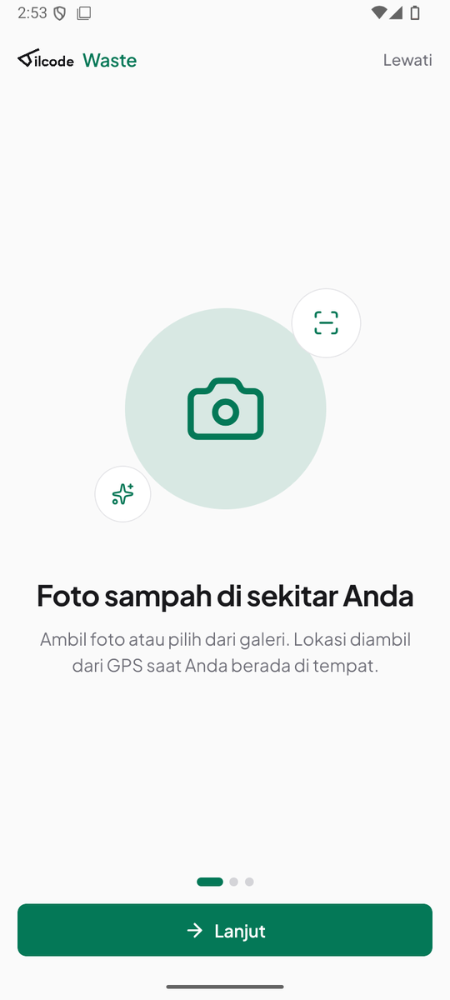
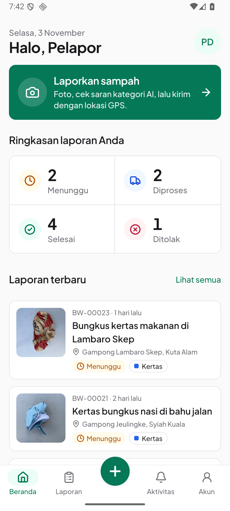
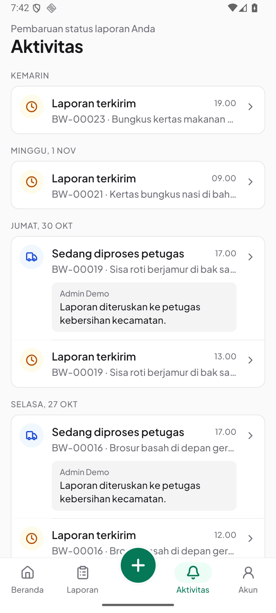
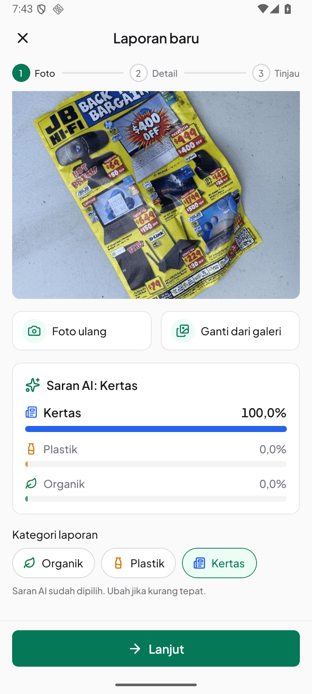
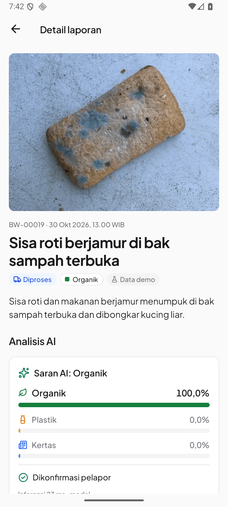

# Aplikasi mobile

Aplikasi Android untuk pelapor, dibangun dengan React Native + Expo SDK 58 (Expo Router) di
`apps/mobile`. Memakai API, kontrak, dan token desain yang sama dengan web.

| Onboarding                             | Beranda                          | Aktivitas                            | Saran AI                              | Detail laporan                     |
| -------------------------------------- | -------------------------------- | ------------------------------------ | ------------------------------------- | ---------------------------------- |
|  |  |  |  |  |

## Fitur

- **Onboarding** 3 slide (foto, kategori AI, pantau penanganan). Selesai atau dilewati disimpan di
  SecureStore; panduan bisa dibuka ulang dari tab Akun.
- **Masuk dan daftar** dalam satu layar, error ditampilkan di field yang bersangkutan, tombol isi akun demo.
  Token sesi (bukan JWT) disimpan di SecureStore dan divalidasi ke `/auth/me` saat aplikasi dibuka.
- **Navigasi**: Beranda dan Laporan di kiri, tombol buat laporan di tengah, Aktivitas dan Akun di kanan.
- **Beranda**: sapaan, ringkasan 4 status (ketuk untuk membuka daftar terfilter), tombol "Laporkan sampah",
  dan 3 laporan terbaru.
- **Laporan**: filter status, infinite scroll, pull-to-refresh. Data lama tetap tampil selama refetch,
  tidak berkedip menjadi spinner.
- **Aktivitas**: setiap perubahan status di semua laporan pelapor, dikelompokkan per hari (WIB), lengkap
  dengan catatan petugas. Ketuk untuk membuka laporan. Diturunkan dari riwayat status yang sudah dikirim
  API, tanpa endpoint baru.
- **Buat laporan** (3 langkah, tetap ter-mount antar langkah):
  1. Foto dari kamera atau galeri, dengan tips foto agar saran AI akurat. Foto diperkecil ke ≤1.600 px dan dikompres di bawah 3 MiB, diunggah,
     lalu dianalisis. Kategori saran AI langsung terpilih dan bisa diubah. Jika AI gagal, tersedia coba
     lagi atau pilih manual; tidak ada hasil yang dikarang.
  2. GPS dengan akurasi dan peta statis, lalu penanda lokasi, judul, dan deskripsi.
  3. Tinjau lalu kirim. `clientRequestId` tetap sama saat dikirim ulang, jadi tidak ada laporan ganda.
- **Detail**: foto, panel AI (3 probabilitas, dikonfirmasi atau diubah pelapor), peta + "Buka di Maps",
  timeline status dengan catatan admin, dan hapus laporan milik sendiri saat masih Menunggu.
- **Akun**: ubah nama, ganti kata sandi (disembunyikan dengan penjelasan untuk akun demo), tema
  Sistem/Terang/Gelap, panduan, versi aplikasi, keluar dengan konfirmasi.

Detail teknis:

- TanStack Query dengan `focusManager` yang terhubung ke `AppState`.
- Animasi Reanimated menghormati pengaturan reduce motion; haptic dipakai pada aksi utama.
- Font Plus Jakarta Sans 400–700, ikon lucide.
- Peta statis disusun dari tile Esri tanpa API key, dan perhitungan tile-nya diuji.
- Edit laporan dan fitur admin sengaja hanya ada di web. Aplikasi mobile ditujukan untuk pelapor di
  lapangan.

## Menjalankan

```bash
cp apps/mobile/.env.example apps/mobile/.env
# EXPO_PUBLIC_API_URL harus berakhiran /api/v1.
# Emulator Android: http://10.0.2.2:3001/api/v1. HP fisik: IP LAN komputer atau URL API produksi.
npm run dev:mobile
```

Buka dengan Expo Go (SDK 58) atau tekan `a` untuk emulator Android. `EXPO_PUBLIC_DEMO_PASSWORD` opsional
untuk menampilkan tombol akun demo. Jangan pernah menaruh secret server di variabel `EXPO_PUBLIC_*`.

## Build APK

```bash
cd apps/mobile
npx eas-cli build --platform android --profile preview
```

Profil `preview` di `eas.json` menghasilkan APK (distribusi internal) dengan URL API produksi. Keystore
dikelola EAS. Ikon dan splash dibuat ulang dengan `node scripts/mobile-icons.mjs`.

| Info           | Nilai                                                                          |
| -------------- | ------------------------------------------------------------------------------ |
| Versi          | 1.0.0 (versionCode 1)                                                          |
| Application ID | `dev.akhyar.bilcodewaste`                                                      |
| Android        | min API 24, target API 36                                                      |
| Unduh          | [GitHub Releases](https://github.com/Akhyarrrrr/bilcode-waste/releases/latest) |

## Verifikasi

- `npm run typecheck -w @bilcode/mobile`, `npm test -w @bilcode/mobile` (32 tes), `npx eslint apps/mobile`,
  `npx expo-doctor` (20/20), dan `npx expo export --platform android` lulus.
- APK 1.0.0 dari EAS diuji di emulator Android API 36 terhadap API produksi:
  - onboarding, login akun demo, Beranda dengan data produksi;
  - foto dari galeri → saran AI "Plastik" dari model produksi → GPS + peta → tinjau → terkirim;
  - admin memproses laporan itu, dan APK menampilkan status "Diproses" beserta catatan admin.
  - tab Aktivitas menampilkan pembaruan status dan catatan admin dari data produksi, dikelompokkan per
    hari WIB, dan membuka detail laporan saat diketuk.
- Mode gelap diuji di emulator.
- Belum diuji di perangkat Android fisik maupun iOS.
- `react-native-worklets` sengaja dipin ke 0.13.1 (Expo SDK 58 mencatat 0.13.0). Reanimated 4.7.1
  meminta `0.13.x`, dan satu salinan menghindari ketidakcocokan native. Versi ini dikecualikan dari
  pengecekan versi Expo di `package.json`.
